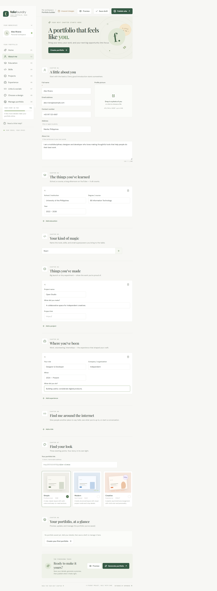
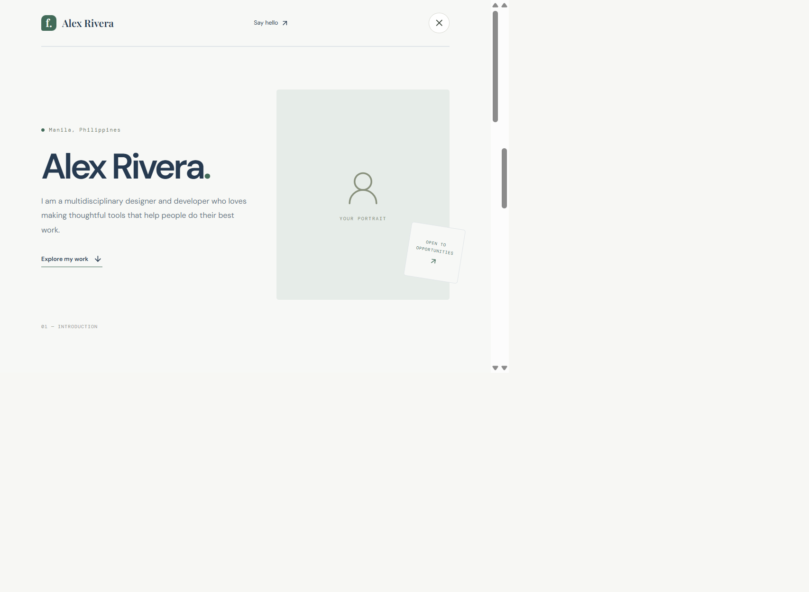
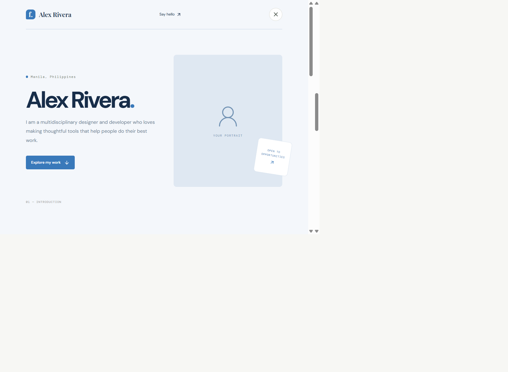
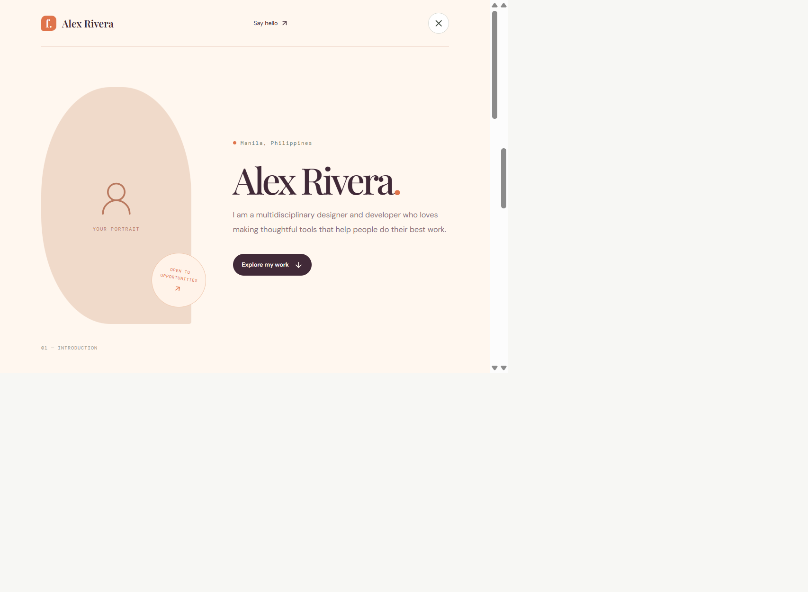
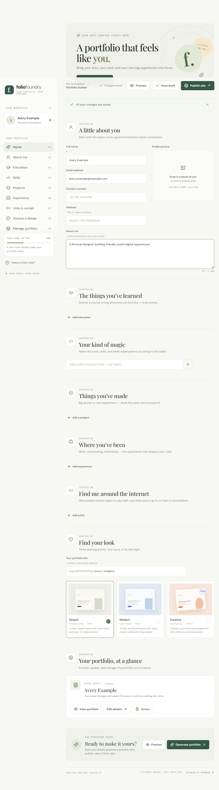

# Folio Foundry

Folio Foundry is a responsive portfolio builder for creating and publishing personal portfolio websites.

**Live site:** [folio-foundry-alpha.vercel.app](https://folio-foundry-alpha.vercel.app)

## Features

- Create an account and manage a portfolio in a private workspace.
- Add profile details, education, skills, projects, experience, social links, and a profile photo.
- Preview and publish a portfolio using three responsive designs: Simple, Modern, or Creative.
- Manage saved portfolios and share their portfolio URLs.
- Edit a draft with clear save-state feedback, then preview changes before publishing.
- See your account name and profile photo in the builder workspace.
- Enjoy readable typography, accessible motion, and interactive transitions throughout the app.

## Screenshots

The screenshots below use fictional sample data.

**Home page and information builder**



**Simple template**



**Modern template**



**Creative template**



Each template has a distinct layout: Simple uses an editorial, spacious style; Modern uses structured cards; and Creative uses an expressive, asymmetrical design. All three adapt to mobile screens.

**Manage portfolio**



## Technology

- React 18 and Vite
- JavaScript and CSS
- Supabase Auth, Postgres, and Storage
- Vercel hosting

## Run locally

Install dependencies and start the development server:

```sh
npm install
npm run dev
```

The public landing page works without Supabase configuration. Account sign-in, the builder, and portfolio management require a configured Supabase project.

## Configure Supabase

1. In your Supabase project, run `supabase/migrations/20261006000000_create_portfolios.sql` in the SQL Editor. This creates the portfolio table, row-level security policies, and profile-photo storage bucket.
2. Run the remaining SQL migrations in `supabase/migrations/` in filename order.
3. In **Authentication → Sign In / Providers**, enable the **Email** and **Google** providers. For Google, create a Web OAuth client in Google Cloud Console, add `https://ortkmjxmiewnjiarokhr.supabase.co/auth/v1/callback` as an authorized redirect URI in Google, then enter the Google client ID and secret in Supabase. The redirect URI must exactly match the Supabase project's callback URL. Keep the client secret in Supabase; do not add it to this frontend app or Vercel.
4. Copy `.env.example` to `.env.local` and set `VITE_SUPABASE_URL` and `VITE_SUPABASE_ANON_KEY` using the values from **Project Settings → API**.
5. In **Authentication → URL Configuration**, set the Site URL to `https://folio-foundry-alpha.vercel.app` and add `http://localhost:5173/login` and `https://folio-foundry-alpha.vercel.app/login` to the allowed redirect URLs. The Site URL must not point to a local development server for production sign-ins.
6. Restart the development server after changing environment variables.

The login page supports email and password as well as **Continue with Google**. Google sign-in requires the Google provider to be configured in Supabase as described above. The app uses Supabase Auth and row-level security to restrict portfolio management to each owner. Published portfolio pages are available to signed-in users. Never expose a Supabase service-role key or Google OAuth client secret in frontend code or environment variables; use only the public anon/publishable key in this app.

## Deploy to Vercel

This project is configured for Vercel. The build command is `npm run build`, the output directory is `dist`, and `vercel.json` rewrites `/login`, `/dashboard`, `/builder`, and `/p/:slug` to the app so those routes work when opened directly.

1. Import the repository in [Vercel](https://vercel.com/new), or select the existing **Folio Foundry** project.
2. Add `VITE_SUPABASE_URL` and `VITE_SUPABASE_ANON_KEY` to the Vercel project's environment variables for the environments you deploy.
3. Deploy the project. If the repository is connected to Vercel, pushing a commit starts a deployment automatically. You can also deploy from the project directory with `npx vercel --prod`.
4. Redeploy after changing environment variables.
5. Add the deployed site URL to Supabase's allowed redirect URLs.

The production site is [folio-foundry-alpha.vercel.app](https://folio-foundry-alpha.vercel.app). Portfolio URLs use the format `https://folio-foundry-alpha.vercel.app/p/your-portfolio-slug`.
